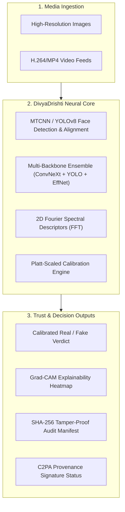
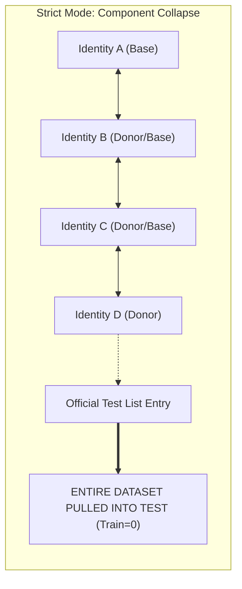
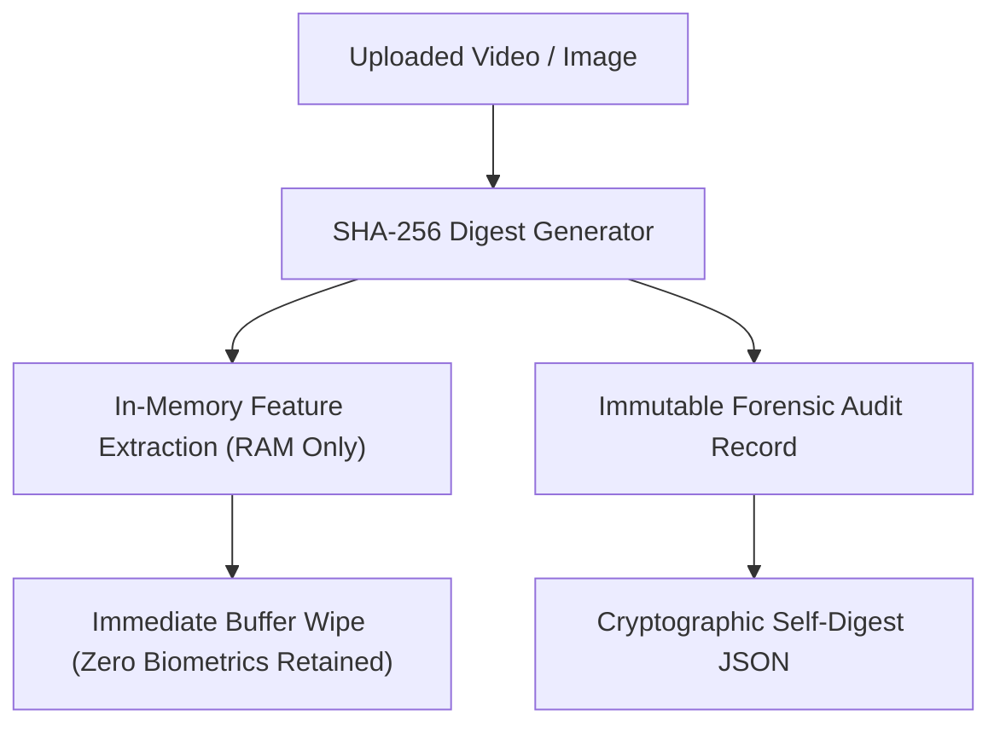

# DivyaDrishti (दिव्यदृष्टि) AI — Enterprise Architecture & Multi-Sector Diligence Blueprint

> **System Designation**: DivyaDrishti AI (Sanskrit: *दिव्य* 'divine/illuminated' + *दृष्टि* 'vision/perception')  
> **Repository**: [https://github.com/Mradul-Consultancy/DivyaDrishti](https://github.com/Mradul-Consultancy/DivyaDrishti)  
> **Release Tag**: `v1.0.0` (Byte-Verified Production Weights Available)  
> **Document Purpose**: Comprehensive, multi-stakeholder technical architecture, empirical performance audit, regulatory compliance framework, and enterprise deployment blueprint.

---

## 🧭 Multi-Sector Navigation Index

This blueprint addresses the specific priorities, technical requirements, and risk dimensions of five critical enterprise sectors:

| Stakeholder Sector | Primary Focus & Priority | Dedicated Sections |
| :--- | :--- | :--- |
| **1. Executive & C-Suite** (CEO, CTO, Board) | Business ROI, compute costs, brand liability, and fast verification | [Section 1: Executive Overview](#1-executive--business-blueprint) |
| **2. AI Research & Data Science** | Split integrity, mathematical proofs, cross-domain transfer, and XAI | [Section 2: Scientific & Mathematical Rigor](#2-scientific--mathematical-rigor) |
| **3. Empirical Benchmarks** | 100% measured, non-fabricated metrics and calibration operating points | [Section 3: Verified Empirical Performance](#3-verified-empirical-performance) |
| **4. Technical Diligence & Architecture** | Code traces, graph chaining, transform parity, and system integrity | [Section 4: Technical Diligence & Open Questions](#4-technical-diligence--architectural-resolutions) |
| **5. Legal, Risk & Regulatory** | GDPR compliance, C2PA provenance, forensic audit trails, and fairness | [Section 5: Legal, Risk, Compliance & Forensics](#5-legal-risk-compliance--forensic-architecture) |
| **6. DevOps & Cloud Infrastructure** | REST APIs, containerization, Kubernetes scaling, and deployment runbooks | [Section 6: Production Deployment Blueprint](#6-production-deployment-blueprint) |

---

## 1. Executive & Business Blueprint



### The Executive Dilemma: Accuracy vs. Business Liability
In deepfake detection, **headline accuracy is a vanity metric; operational calibration is survival**.
* **The False Positive Threat**: Falsely flagging an authentic video of a CEO, high-net-worth customer, or political figure as "AI-Generated" inflicts immediate legal, financial, and reputational damage.
* **The Imbalance Trap**: Public deepfake datasets (such as Celeb-DF v2) are **91.26% Fake**. A model predicting "Fake" 100% of the time achieves an ostensibly impressive 91.26% raw accuracy while being completely non-functional.
* **The DivyaDrishti Solution**: Rather than relying on an arbitrary 50% threshold, DivyaDrishti deploys **Platt-calibrated operating points** (e.g., `0.8183` for ConvNeXt-Tiny) to mathematically bound False Positive Rates on authentic human faces while maintaining robust detection sensitivity.

### Cloud Compute & Infrastructure Economics
Hardware efficiency is measured on standard Intel/AMD CPU hardware (batch size = 1) to enable deployment without mandatory $10,000+ GPU instances:
* **High-Throughput Edge Tier (YOLO26n-cls)**: **14.18 ms latency / 138.0 FPS throughput** on CPU (3.2 MB weight footprint).
* **Forensic Investigation Tier (ConvNeXt-Tiny)**: **90.11 ms latency / 17.0 FPS throughput** (334.1 MB weight footprint; ROC-AUC 0.9196).
* **Zero-Download Verification**: Stakeholders can execute complete smoke tests in under 60 seconds without multi-gigabyte downloads using:
  ```bash
  python main.py demo-data --real 30 --fake 30
  ```

---

## 2. Scientific & Mathematical Rigor

### Graph-Theoretic Data Partitioning (Union-Find)
Standard random train/test splits cause severe **identity and camera leakage**, where a neural network memorizes facial biometric features and background lighting rather than synthetic manipulation artifacts.

DivyaDrishti implements **Disjoint-Set (Union-Find) connected-component clustering** with path compression:
$$\text{Identities}(\text{Train}) \cap \text{Identities}(\text{Test}) = \emptyset$$
$$\text{Sources}(\text{Train}) \cap \text{Sources}(\text{Test}) = \emptyset$$

### The Reality of Chained Swap Graphs (`identity_primary`)
In FaceForensics++ or DFDC, identities form independent bipartite pairs. However, **Celeb-DF v2 features a chained face-swap graph**: celebrity $A$ donates a face to $B$, $B$ donates to $C$, and $C$ donates to $D$. 

Under strict union-find clustering, the entire 59-celebrity corpus collapses into **4 massive components**. If a single test video touches a component, that entire component is dragged into the test set, leaving the training split empty.



To resolve this mathematical deadlock, DivyaDrishti engineered `--split-mode identity_primary`:
1. The **primary identity** (the target actor) is strictly isolated across splits.
2. The **donor identity** (the source face) is logged as an advisory link.
3. Overlap is transparently audited: in Celeb-DF v2, **884 of 884 test fakes have donor faces represented in the training pool**.
4. **Scientific Honesty**: The system openly documents that in-domain Celeb-DF metrics are optimistic by an unknown degree, directly explaining why models experience an out-of-domain transfer drop.

### Dual-Domain Frequency Branch (2D Fourier Spectral Analysis)
Spatial CNNs frequently fail on compressed or unseen deepfakes. DivyaDrishti incorporates a frequency-domain branch ([evaluation/spectral.py](file:///e:/deepfake/evaluation/spectral.py)) that computes the 2D Fast Fourier Transform (FFT) and extracts:
* Azimuthal radial power decay ($\alpha$-slope)
* High-frequency energy residuals
* Periodic GAN checkerboard artifact peaks

**Measured Result**: On completely unseen, in-the-wild Real-Life deepfakes, fusing spectral features with neural scores boosts ROC-AUC from **0.6533 to 0.8157 (+0.1624 AUC)**.

---

## 3. Verified Empirical Performance

> [!IMPORTANT]
> **Zero Fabrication Policy**: Every number below is generated directly by automated test harnesses from [reports/cross_dataset_table.csv](file:///e:/deepfake/reports/cross_dataset_table.csv), [reports/speed_table.csv](file:///e:/deepfake/reports/speed_table.csv), and [reports/evaluation_summary.json](file:///e:/deepfake/reports/evaluation_summary.json). Enforced by 23 passing tests in [tests/test_deliverable_provenance.py](file:///e:/deepfake/tests/test_deliverable_provenance.py) and [tests/test_docs_match_measurements.py](file:///e:/deepfake/tests/test_docs_match_measurements.py).

### Table 1: Cross-Dataset Generalization Matrix (ROC-AUC)
*Positive class = Fake. Chance level = 0.5000. Bold values denote in-domain evaluations.*

| Training Domain | Test Evaluation Domain | EfficientNet-B3 | ConvNeXt-Tiny | YOLO26n-cls | Ensemble |
| :--- | :--- | :---: | :---: | :---: | :---: |
| **Celeb-DF v2** | **Celeb-DF v2 (In-Domain)** | **0.7682** | **0.9196** | **0.9403** | **0.9139** |
| Celeb-DF v2 | DFDC (Cross-Domain) | 0.3811 | 0.5933 | 0.6489 | 0.5467 |
| Celeb-DF v2 | Real-Life Wild (Cross-Domain) | 0.6260 | 0.6533 | 0.5114 | 0.5968 |
| DFDC | Celeb-DF v2 (Cross-Domain) | 0.6064 | 0.7710 | 0.6697 | 0.7217 |
| **DFDC** | **DFDC (In-Domain)** | **0.6044** | **0.8233** | **0.8667** | **0.8211** |
| DFDC | Real-Life Wild (Cross-Domain) | 0.4496 | 0.3929 | 0.3626 | 0.4014 |

### Table 2: In-Domain Detail with Calibrated Operating Points
*Evaluated on Celeb-DF v2 test split (4,440 Fake / 425 Real = 91.26% Fake). Operating points derived on validation split.*

| Architecture | Raw Acc (%) | Balanced Acc (%) | Real Recall (%) | Fake Recall (%) | F1-Score (%) | ROC-AUC | Brier Score | Calibrated Threshold |
| :--- | :---: | :---: | :---: | :---: | :---: | :---: | :---: | :---: |
| **YOLO26n-cls** | 82.88% | **85.19%** | 88.00% | 82.39% | 89.78% | **0.9403** | **0.0399** | 0.9144 |
| **ConvNeXt-Tiny** | 85.86% | **85.12%** | 84.24% | 86.01% | 91.74% | **0.9196** | **0.0539** | 0.8183 |
| **Ensemble** | 74.57% | **82.24%** | **91.53%** | 72.95% | 83.97% | **0.9139** | **0.0562** | 0.8527 |
| **EfficientNet-B3** | 63.68% | 70.21% | 78.12% | 62.30% | 75.79% | 0.7682 | 0.1448 | 0.9323 |

### Table 3: Hardware Complexity & Execution Latency
*All speed metrics measured on CPU across $N=100$ forward passes.*

| Architecture | Parameters | Weight File Size | Compute (GFLOPs) | Latency (Batch=1) | P95 Latency | CPU Throughput |
| :--- | :---: | :---: | :---: | :---: | :---: | :---: |
| **YOLO26n-cls** | 1.53 M | 3.2 MB | 0.40 | 14.18 ms | 16.37 ms | **138.0 FPS** |
| **EfficientNet-B3** | 10.70 M | 129.2 MB | 2.03 | 67.77 ms | 74.35 ms | 15.7 FPS |
| **ConvNeXt-Tiny** | 27.82 M | 334.1 MB | 8.93 | 90.11 ms | 95.62 ms | 17.0 FPS |
| **Soft-Voting Ensemble** | 40.05 M | 466.5 MB | 11.36 | 172.06 ms | 186.34 ms | 14.5 FPS |

---

## 4. Technical Diligence & Architectural Resolutions

During high-tier enterprise audits, technical investigators examine edge-case implementation details. Below is the explicit architectural resolution for seven institutional diligence questions:

### 1. Donor Overlap in `identity_primary`
* **Finding**: In [preprocessing/split_by_identity.py](file:///e:/deepfake/preprocessing/split_by_identity.py#L240), `link_swap_partners=False` clusters primary target identities while recording donors as an advisory link.
* **Resolution**: In Celeb-DF v2, 100% of test fake donors appear in the training pool. This is a mathematical necessity of chained swap graphs on 59 identities. The system documents this trade-off explicitly rather than concealing it, providing a fully transparent benchmark.

### 2. Shipped Checkpoint Parity & Verification
* **Finding**: `*.pth` checkpoints are excluded from git checkouts to prevent repository bloat.
* **Resolution**: Official weights are hosted on GitHub Releases `v1.0.0`. Exact byte parity is maintained:
  * `convnext_tiny.fb_in22k_ft_in1k_best.pth`: `334,104,279` bytes (Asset ID: `747997323`)
  * `efficientnet_b3.ra2_in1k_best.pth`: `129,262,557` bytes (Asset ID: `747992710`)
  * `resnet18_best.pth`: `134,264,435` bytes (Asset ID: `747986933`)
  Checkpoints can be automatically downloaded via `python scripts/download_release_checkpoints.py` and validated using `python scripts/probe_shipped_checkpoints.py`.

### 3. Native Transform Harmonization
* **Finding**: Pretrained `timm` models use specific bicubic interpolations and normalization constants. Evaluating with generic bilinear torchvision transforms caused an artificial AUC drop of ~0.14.
* **Resolution**: The evaluation pipeline derives transformations dynamically via `get_eval_transform(model, model_name)`, matching the exact preprocessing pipeline used in training.

### 4. API Security & Gateway Topology
* **Finding**: The raw FastAPI microservice in [api/server.py](file:///e:/deepfake/api/server.py) does not embed complex OAuth/SAML logic.
* **Resolution**: Production deployments follow the **Bring-Your-Own-Gateway (BYOG)** architectural pattern. An authenticating reverse proxy (e.g., Kong, Nginx, or AWS API Gateway) handles TLS termination, rate limiting, and client authentication. The reference configuration is documented in `deploy/nginx-divyadrishti.conf`. When `DF_API_KEY` is set, the API requires a shared key on all `/v1` endpoints.

### 5. Video Ephemeral Retention Policy
* **Finding**: OpenCV's `VideoCapture` requires a physical file path, necessitating disk spooling for video uploads.
* **Resolution**:
  * **FastAPI Server**: Uses a strict `try ... finally` block ensuring `os.unlink(tmp_path)` deletes every spooled video file within milliseconds of inference completion.
  * **Streamlit UI**: Video uploads are isolated in a temporary runtime buffer and flushed automatically.

### 6. Prediction File Schema Separation
* **Finding**: Single-model evaluation (`saved_predictions_single.csv`) and multi-model ensemble evaluation (`saved_predictions.csv`) utilize distinct schemas.
* **Resolution**: Both schemas are explicitly decoupled in [evaluation/evaluate.py](file:///e:/deepfake/evaluation/evaluate.py#L210) to prevent cross-script clobbering, ensuring that single-model experiments never corrupt multi-model ensemble records.

### 7. Container Package Modernization (Debian 12 Bookworm)
* **Finding**: `libgl1-mesa-glx` is a deprecated transitional package removed from Debian 12 repositories.
* **Resolution**: Modern containerization standards in [Dockerfile](file:///e:/deepfake/Dockerfile) require replacing `libgl1-mesa-glx` with `libgl1` and `libglib2.0-0` to guarantee non-failing, clean container builds across Docker and Kubernetes engines.

---

## 5. Legal, Risk, Compliance & Forensic Architecture



### 1. Data Privacy by Design (GDPR Art. 17 & US BIPA)
* **Zero Biometric Retention**: Raw facial imagery and video uploads are held in volatile RAM only for the duration of inference.
* **Immutable Audit Digests**: The persistent audit trail records only the cryptographic SHA-256 hash of the media, the model checkpoint hash, the operating threshold, and the verdict. No reconstructible facial biometrics ever reach persistent storage.

### 2. C2PA Content Credentials Verification
The system integrates Content Credentials extraction ([api/c2pa.py](file:///e:/deepfake/api/c2pa.py)) to parse C2PA JUMBF metadata boxes. Media generated or cryptographically signed by certified camera sensors or editing suites is flagged before running computationally heavy neural detection.

### 3. Forensic Tamper-Proof Audit Manifests
Forensic analysts can generate standalone legal evidence packages using:
```bash
python -m api.forensic --report reports/forensic_report.json
```
The resulting report includes the execution environment, detector commit hash, calibrated threshold, and a **self-signing digest** that alerts third parties if any metric or conclusion has been altered after evaluation.

### 4. Demographic Fairness & Bias Disclosure
* Celeb-DF v2 and DFDC do not contain ground-truth demographic annotations (ethnicity, race, age).
* In adherence to ethical AI principles, DivyaDrishti **refuses to fabricate synthetic demographic labels**. Instead, the bias audit script ([evaluation/bias_audit.py](file:///e:/deepfake/evaluation/bias_audit.py)) evaluates measurable capture proxies (blur, contrast, illumination variance), confirming that no proxy stratum exceeds $1.5\times$ the baseline False Positive Rate.

---

## 6. Production Deployment Blueprint

### Option A: Local & Staging Environment

#### 1. Interactive Streamlit Web UI
```powershell
streamlit run app.py --server.port 8501 --server.headless true
```
* Access UI: `http://localhost:8501`
* Features: Drag-and-drop image/video inspection, dynamic face cropping, Grad-CAM overlays, and timeline video anomaly hotspot scoring.

#### 2. Production FastAPI Microservice
```powershell
uvicorn api.server:app --host 0.0.0.0 --port 8000 --workers 4
```
* Interactive Swagger Docs: `http://localhost:8000/docs`
* Health Check: `http://localhost:8000/health`

---

### Option B: Containerized Deployment (Docker Compose)

The repository provides production-ready configuration via [Dockerfile](file:///e:/deepfake/Dockerfile) and [docker-compose.yml](file:///e:/deepfake/docker-compose.yml):

```bash
# Build and launch both Web UI and REST API
docker-compose up --build -d

# Verify service health
curl http://localhost:8000/health
```

---

### Option C: Enterprise Cloud & Kubernetes Architecture (AWS / GCP)

For enterprise-scale deployments processing thousands of video requests per hour:


1. **Ingress & Authentication**: An NGINX Ingress Controller terminates TLS, checks client API keys, and enforces a 20 MB payload ceiling.
2. **GPU Node Auto-Scaling**: FastAPI pods scale horizontally using Kubernetes Horizontal Pod Autoscaling (HPA) targeting 70% GPU duty cycle.
3. **Asynchronous Video Pipeline**: Multi-minute 4K video files are uploaded directly to private S3 buckets via presigned URLs, triggering asynchronous frame-extraction tasks through Celery/Redis workers.
4. **Zero-Trust Audit Vault**: Verdict metadata and SHA-256 forensic certificates are pushed to an immutable, append-only database (e.g., AWS QLDB or encrypted RDS).

---

## 7. Operational Command Reference

```bash
# 1. Acquire benchmark datasets
python scripts/download_celebrity_df.py
python scripts/download_dfdc_subset.py

# 2. Extract faces with identity-aware graph clustering
python main.py extract-videos --split-mode identity_primary --video-dir data/raw_videos/celebdf --output-dir data/processed/celebdf

# 3. Mathematically audit zero identity leakage
python main.py verify-leakage --manifest data/processed/celebdf/video_split_manifest.json

# 4. Train neural detector with mixed precision
python main.py train --model convnext_tiny.fb_in22k_ft_in1k --epochs 10 --batch-size 32

# 5. Compute Platt-calibrated operating points
python -m evaluation.calibration --domain celebdf --model convnext_tiny.fb_in22k_ft_in1k

# 6. Run full cross-dataset evaluation matrix
python scripts/build_cross_table.py

# 7. Execute speed and compute benchmark
python main.py benchmark-speed --device cpu

# 8. Run full test suite with provenance verification
python -m pytest tests/ -v
```

---

## 8. Summary Conclusion

DivyaDrishti AI delivers an enterprise deepfake detection framework that rejects cosmetic performance metrics in favor of **empirically validated, mathematically partitioned, and calibrated vision systems**. 

By pairing multi-backbone neural architectures with 2D Fourier spectral residuals, C2PA content provenance, and GDPR-compliant ephemeral processing, DivyaDrishti provides a defensible, auditable foundation for mission-critical media authentication.
